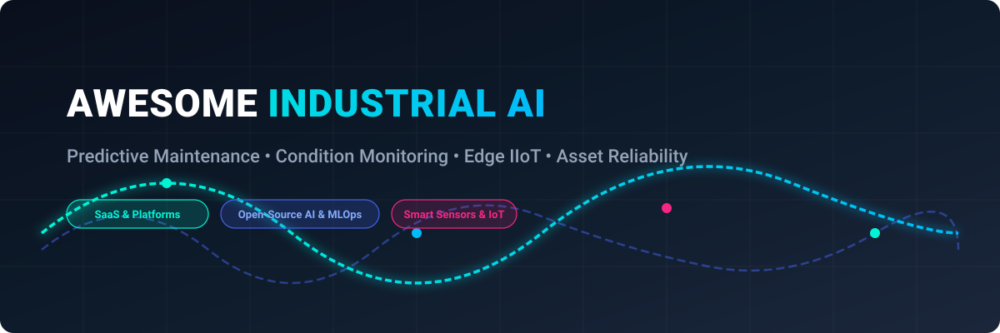

  

# 🏭 Awesome Industrial AI & Predictive Maintenance 🚀

  
  
  
  
  
  

## 📌 Top Industrial AI, Condition Monitoring & Predictive Maintenance Ecosystem

**Curated List of SaaS Platforms & Open-Source GitHub Projects**  
*Comprehensive landscape of Industrial AI, Anomaly Detection, Machine Health, Digital Twins, and Predictive Maintenance*  
**Last updated: March 2026**

This repository tracks notable **SaaS platforms** and **open-source projects** building **Industrial AI and Predictive Maintenance (PdM)** solutions. These tools leverage high-frequency sensor telemetry (vibration, temperature, ultrasound, motor current signature analysis, pressure), edge IIoT gateways, machine learning, and autonomous AI agents to predict catastrophic equipment failures, eliminate unplanned downtime, optimize work orders, and enhance overall equipment effectiveness (OEE) across manufacturing, energy, chemicals, and heavy industry.

---

## 📑 Table of Contents
- [🌐 SaaS Products](#-saas-products)
  - [Market Overview & Structure](#-market-overview--structure)
  - [Core Industrial AI & Predictive Maintenance Platforms](#-core-industrial-ai--predictive-maintenance-platforms)
  - [Advanced CMMS & Maintenance Automation Platforms](#-advanced-cmms--maintenance-automation-platforms)
- [💻 Open-Source GitHub Projects](#-open-source-github-projects)
  - [Dedicated Predictive Maintenance & Industrial AI Repositories](#-dedicated-predictive-maintenance--industrial-ai-repositories)
  - [Additional Open-Source Industrial & ML Frameworks](#-additional-open-source-industrial--ml-frameworks)
- [🤝 How to Contribute](#-how-to-contribute)
- [⚠️ Disclaimer](#-disclaimer)
- [⭐ Star History](#-star-history)

---

## 🌐 SaaS Products

### 📊 Market Overview & Structure

> The global predictive maintenance and industrial AI market is estimated at **$7.8 billion in 2026** (projected to reach over **$24.5 billion by 2030** at a CAGR of ~28%), exhibiting a **moderately fragmented** structure where legacy enterprise conglomerates (IBM, Siemens, GE Vernova, Rockwell/PTC) compete with specialized high-growth AI sensor innovators (Augury, TRACTIAN, Uptake, UptimeAI, Nanoprecise) with no single winner-take-all monopoly.

### 🏭 Core Industrial AI & Predictive Maintenance Platforms

| Platform | Company Size (Revenue / Valuation) | Description | Pricing (Starting Tier) | Free Tier / Trial Limits |
| :--- | :--- | :--- | :--- | :--- |
| **[Siemens MindSphere (Insights Hub)](https://www.siemens.com/global/en/products/automation/mindsphere.html)** | **~$82.5B Annual Revenue** (Siemens AG) | Cloud-based industrial IoT solution with powerful analytics, digital twin capability, and predictive maintenance tools. | From €250/month (~$270/month for Insights Hub Basic/Essentials capability package; usage add-ons apply) | Free forever ("Start for Free" light edition with basic asset connectivity, ingestion, and anomaly detection) |
| **[IBM Maximo](https://www.ibm.com/products/maximo)** | **~$62.0B Annual Revenue** (IBM Corp) | Enterprise asset management (EAM) and APM suite with AI and IoT capabilities for predictive maintenance and reliability. | From ~$3,150/month (IBM Maximo Application Suite Essentials tier via AppPoints consumption model) | 14-day free trial (includes Maximo Manage and Maximo Health modules preloaded with sample data) |
| **[GE Digital / GE Vernova (Predix APM)](https://www.ge.com/digital/)** | **~$35.0B Annual Revenue** (GE Vernova) | Enterprise industrial cloud platform with advanced predictive maintenance and asset performance management (APM). | From ~$8,333/month (~$100,000/year enterprise base deployment tier for monitored critical assets) | No free tier for enterprise APM; guided interactive demo available (free 30-day trials offered for companion Proficy software) |
| **[PTC ThingWorx](https://www.ptc.com/en/products/thingworx)** | **~$2.2B Annual Revenue** / ~$21B Market Cap | Industrial IoT platform enabling rapid development of predictive maintenance, asset monitoring, and digital twin applications. | From ~$4,166/month (~$50,000/year base platform deployment license for connected assets) | No public free trial (developer hosted trials discontinued); academic/eval license available on sales approval |
| **[Augury](https://www.augury.com/)** | **~$1.0B Valuation** (Unicorn, Series E) | Leading AI-powered machine health platform using vibration, ultrasound, and process data for early fault detection and prescriptive maintenance recommendations. | From ~$50–$150/machine/month (bundled Diagnostics-as-a-Service annual contract; hardware included) | No free tier; custom pilot/POC available upon qualification (typically 30–90 days for selected assets) |
| **[TRACTIAN](https://tractian.com/)** | **~$1.0B Valuation** (Series B Unicorn) | Smart sensors + AI platform combining condition monitoring, predictive maintenance, and CMMS in one solution. Popular for fast deployment and strong ROI in manufacturing. | From $60/month (CMMS Standard tier for up to 5 users); Smart Trac vibration sensors via Hardware-as-a-Service subscription | 90-day trial pilot program for vibration monitoring (hardware/installation terms apply; requires definitive documentation) |
| **[Uptake](https://www.uptake.com/)** | **~$1.0B Valuation** | AI-driven industrial intelligence platform offering predictive maintenance and asset performance management. | From ~$8,333/month (~$100,000/year annual pilot contract for 10–50 assets) | No perpetual free plan; guided demo and structured multi-week pilot evaluation on 10–50 assets |
| **[Nanoprecise Sci Corp](https://nanoprecise.com/)** | **~$100M Valuation** | Wireless 6-in-1 IoT sensors and AI platform delivering predictive condition monitoring with automated fault diagnosis. | From ~$30–$50/sensor/month (annual subscription bundling hardware and cloud analytics) | No perpetual free plan; 30-minute interactive demo + 30–60 day customer pilot; up to 70% money-back guarantee if ROI unmet in year 1 |
| **[Infinite Uptime](https://www.infiniteuptime.com/)** | **~$70M Valuation** | AI-driven predictive maintenance platform focused on mechanical reliability, high-frequency vibration, and zero downtime. | From ~$400/month (~$5,000 minimum project engagement for sensor nodes and PlantOS analytics) | No perpetual free tier; free guided platform demo and custom 30–60 day reliability pilot |
| **[UptimeAI](https://www.uptimeai.com/)** | **~$40M Valuation** | Industrial AI platform focused on predictive analytics, anomaly detection, and root cause analysis for critical plant equipment. | From ~$5,000/month (enterprise contracts scaled by sensor tags/system capacity via AWS/Azure Marketplace) | No free tier; guided pilot program available (typically 4–8 weeks on selected critical subsystem tags) |
| **[Sensemore](https://sensemore.io/)** | **~$15M Valuation** | AI-based predictive maintenance solution with advanced vibration analytics and wireless condition monitoring sensors. | From ~$250/month (entry sensor cloud subscription pack for small machine fleets) | 30-day free trial (includes access to LAKE cloud platform onboarding with pre-populated sample data) |

### 🔧 Advanced CMMS & Maintenance Automation Platforms

| Platform | Company Size (Revenue / Valuation) | Description | Pricing (Starting Tier) | Free Tier / Trial Limits |
| :--- | :--- | :--- | :--- | :--- |
| **[Fiix](https://www.fiixsoftware.com/)** | **~$9.0B Annual Revenue** (Parent: Rockwell Automation) | AI-powered cloud CMMS by Rockwell Automation providing asset tracking, work order automation, and Foresight AI failure prediction. | From $45/user/month (Basic tier; Professional tier with Foresight AI starts at $75/user/month) | Free forever plan (up to 3 active users, 25 preventive maintenance tasks, unlimited work orders, no credit card required) |
| **[MaintainX](https://www.getmaintainx.com/)** | **~$1.0B Valuation** (Series C Unicorn) | Mobile-first CMMS and work order management platform with IoT sensor integration and predictive maintenance workflows. | From $20/user/month billed annually ($25/user billed monthly for Essential tier) | Free forever Basic plan (unlimited work orders, unlimited requester users, restricted to 2 repeating work orders and 1 month analytics history) |
| **[UpKeep](https://www.upkeep.com/)** | **~$350M Valuation** | Modern CMMS and Asset Operations Management system with condition monitoring sensor integrations and predictive maintenance. | From $20/user/month (Starter/Essential tier billed annually) | 7-day free trial with full feature access; free unlimited view-only and requester accounts |
| **[Factory AI](https://factoryai.com/)** | **~$20M Valuation** | Industrial IoT condition monitoring and predictive maintenance platform designed specifically for manufacturing operations. | From ~$500 AUD/asset/year (~$320 USD/asset/year all-inclusive hardware, software, and analytics) | No self-serve free trial; guided factory pilot and interactive demo available upon consultation |

---

## 💻 Open-Source GitHub Projects

### 🛠️ Dedicated Predictive Maintenance & Industrial AI Repositories

*Sorted by GitHub Star Count (Descending)*

1. **[ydataai/ydata-synthetic](https://github.com/ydataai/ydata-synthetic)**   
   Synthetic structured and time-series data generators (TimeGAN, CTGAN) tailored for industrial equipment sensors, cold-start machine telemetry, and predictive maintenance failure benchmarks.

2. **[Azure/Industrial-IoT](https://github.com/Azure/Industrial-IoT)**   
   Microsoft Azure Industrial IoT edge components and cloud services connecting OPC UA machinery, telemetry processing, and asset twins to predictive AI pipelines.

3. **[awslabs/predictive-maintenance-using-machine-learning](https://github.com/awslabs/predictive-maintenance-using-machine-learning)**   
   End-to-end predictive maintenance solution architecture using AWS SageMaker, anomaly detection models, and turbofan engine degradation benchmarks.

4. **[HROlive/Applications-of-AI-for-Predictive-Maintenance](https://github.com/HROlive/Applications-of-AI-for-Predictive-Maintenance)**   
   Deep learning models and NVIDIA Deep Learning Institute (DLI) implementations for Remaining Useful Life (RUL) estimation, bearing degradation, and unsupervised anomaly detection.

5. **[LGDiMaggio/predictive-maintenance-mcp](https://github.com/LGDiMaggio/predictive-maintenance-mcp)**   
   Open-source predictive maintenance AI agent and condition monitoring copilot using Model Context Protocol (MCP). Turns LLMs into diagnostic assistants for vibration analysis, fault detection, and RUL estimation.

6. **[caglarmert/awesome-predictive-maintenance](https://github.com/caglarmert/awesome-predictive-maintenance)**   
   Curated compilation of academic research papers, industrial vibration datasets, benchmarks, and baseline predictive maintenance algorithms.

7. **[adityapotdar23/Predictive-Maintenance](https://github.com/adityapotdar23/Predictive-Maintenance)**   
   AI Kavach: Machine learning solution for industrial machinery health forecasting, sensory threshold anomaly tracking, and automated maintenance triggers.

8. **[autonlab/pmx_data](https://github.com/autonlab/pmx_data)**   
   Comprehensive dataset repository, standardized data loaders, and code utilities for benchmarking predictive maintenance models on industrial run-to-failure datasets.

9. **[Sa1f27/predictive-maintenance-mlops](https://github.com/Sa1f27/predictive-maintenance-mlops)**   
   End-to-end MLOps pipeline for sensor-based predictive maintenance with automated experiment tracking, model registry, and containerized deployment.

10. **[samueldata/predictive-maintenance](https://github.com/samueldata/predictive-maintenance)**   
    Full-lifecycle predictive maintenance analytics engine using machine learning to forecast machinery degradation curves and calculate optimal repair windows.

11. **[aws-samples/amazon-lookout-for-equipment-python-sdk](https://github.com/aws-samples/amazon-lookout-for-equipment-python-sdk)**   
    Open-source Python SDK and reference architectures facilitating multivariate anomaly detection and predictive maintenance with sensor time-series data.

12. **[jordandelbar/predictive-maintenance-showcase](https://github.com/jordandelbar/predictive-maintenance-showcase)**   
    Real-time predictive maintenance demonstration using autoencoder deep learning neural networks to isolate subtle sensor anomalies before component failure.

13. **[Mic-360/iot-predictive-maintainance-system](https://github.com/Mic-360/iot-predictive-maintainance-system)**   
    IoT-based equipment monitoring architecture with telemetry capture, threshold alerting, and maintenance task dispatching powered by ML models.

### ⚙️ Additional Open-Source Industrial & ML Frameworks

- **[ThingsBoard](https://github.com/thingsboard/thingsboard)**  — Open-source IoT platform for data collection, telemetry processing, rule engine alerts, and predictive asset dashboards.
- **[Eclipse Milo](https://github.com/eclipse-milo/milo)**  — Open-source Java implementation of OPC UA (IEC 62541) for connecting SCADA, PLCs, and factory machinery to analytics engines.
- **[Eclipse Ditto](https://github.com/eclipse-ditto/ditto)**  — Open-source digital twin framework bridging physical industrial assets and digital services.
- **[FA³ST Service](https://github.com/FraunhoferIOSB/FAAAST-Service)**  — Fraunhofer IOSB implementation of Asset Administration Shell (AAS) for Industry 4.0 interoperability.
- **openMAINT** — Open-source CMMS/EAM platform built on CMDBuild for plant maintenance and equipment lifecycle management.
- **CalemEAM** — Open-source enterprise asset management supporting preventive and predictive maintenance scheduling.
- **KNIME & WEKA** — Open-source data science tools providing modular workflows for training vibration and remaining useful life (RUL) models.

---

## 🤝 How to Contribute

1. 🍴 Fork the repository.
2. 📝 Add or update entries in [README.md](file:///C:/Users/ishan/Documents/Projects/Awesome-Industrial-AI/README.md) following the existing tabular or badge format.
3. 🔗 Include: name, official link, stargazers count / pricing tiers, and a concise 1–2 sentence description.
4. 🚀 Submit a Pull Request with a clear summary of your additions.

⭐ *Star this repository if you find it valuable for your engineering and reliability work!*

---

## ⚠️ Disclaimer

- This is an independent, **community-curated** catalog — not an exhaustive registry or formal commercial endorsement.
- Predictive maintenance and condition monitoring solutions should always be tested, calibrated, and validated with licensed reliability engineers.
- Always ensure compliance with industrial safety mandates (e.g., ISO 55001, ISO 13374 for condition monitoring, IEC 62443 cybersecurity standards).
- AI models and anomaly detectors are decision-support tools and **not direct replacements** for certified safety instrumented systems (SIS) or routine manual inspections.

---

## ⭐ Star History

---

  <b>Built for Reliability Engineers, Plant Managers, IIoT Developers &amp; Industrial AI Researchers ⚙️</b>

